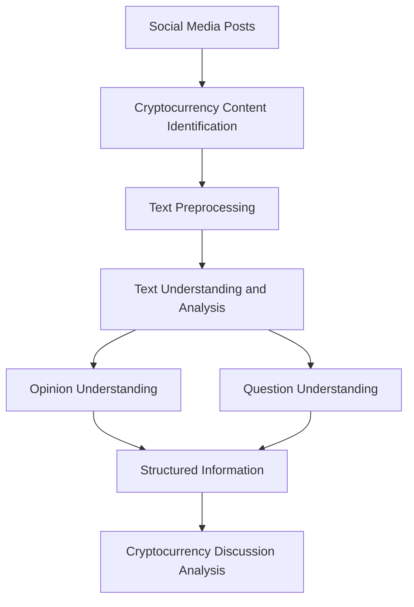

# CryptOQA
### Understanding Cryptocurrency-Related Opinions and Questions from Social Media Posts

<p align="center">
  
  
  
  
</p>

---

## 📌 1. Project Overview

**CryptOQA (Understanding Cryptocurrency-Related Opinions and Questions from Social Media Posts)** is a project focused on analysing cryptocurrency-related discussions shared through social media platforms.

Social media has become an important source of information for cryptocurrency investors, researchers, developers, and enthusiasts. People frequently share opinions, ask questions, discuss market movements, exchange knowledge, and express concerns about different cryptocurrencies.

These discussions contain valuable information, but extracting meaningful insights from large volumes of unstructured social media content can be challenging.

CryptOQA explores the use of Natural Language Processing (NLP) and computational text analysis to understand cryptocurrency-related opinions and questions expressed in social media posts.

The primary research objective is to make cryptocurrency-related social media information easier to process, understand, and analyse.

## 🎯 2. Project Objectives

The major objectives of CryptOQA include:

- Understand cryptocurrency-related discussions on social media.
- Identify posts containing cryptocurrency-related information.
- Analyse opinions expressed by social media users.
- Identify questions related to cryptocurrencies.
- Process unstructured social media text.
- Extract meaningful information from cryptocurrency discussions.
- Explore NLP-based approaches for understanding user-generated content.
- Support structured analysis of cryptocurrency-related opinions and questions.

## ❗ 3. Problem Statement

Cryptocurrency discussions generate enormous amounts of user-generated content across social media platforms.

Users continuously share opinions, ask questions, discuss blockchain technologies, express market expectations, and exchange information about different digital currencies.

However, this information is generally available in unstructured textual formats.

Manually reviewing these discussions is time-consuming and makes it difficult to identify important questions, recurring opinions, and useful information.

Traditional keyword-based approaches may also fail to capture the contextual meaning of a discussion.

Therefore, there is a need for computational approaches that can process cryptocurrency-related social media posts and help understand the opinions and questions expressed within them.

CryptOQA explores this research problem through social media text understanding and NLP-based analysis.

## 💡 4. Proposed Approach

CryptOQA focuses on processing cryptocurrency-related social media content and extracting meaningful information from discussions.

The conceptual workflow consists of the following stages:

### 4.1 Social Media Content

Social media posts containing cryptocurrency-related information serve as the source of textual content.

These posts may include:

- Cryptocurrency-related questions.
- User opinions and viewpoints.
- Discussions about digital currencies.
- Cryptocurrency terminology.
- Market-related discussions.
- Blockchain-related information.

### 4.2 Text Preprocessing

Social media content may contain informal language, hashtags, URLs, mentions, abbreviations, and other textual elements.

Text preprocessing prepares the collected content for further analysis.

Potential preprocessing operations include:

- Text cleaning.
- Removal of unnecessary characters.
- Handling URLs and mentions.
- Tokenization.
- Normalization.
- Removal of irrelevant information.

The exact preprocessing operations depend on the implemented pipeline.

### 4.3 Cryptocurrency-Related Content Understanding

The processed text is examined to identify information relevant to cryptocurrency discussions.

This stage focuses on understanding the context and identifying meaningful cryptocurrency-related content.

### 4.4 Opinion and Question Understanding

The central research focus is understanding two important types of information:

**Opinions:**
- User viewpoints.
- Personal perspectives.
- Positive or negative expressions.
- Cryptocurrency-related observations.

**Questions:**
- Information-seeking queries.
- Technical cryptocurrency questions.
- General cryptocurrency-related questions.
- Questions about blockchain concepts and digital currencies.

### 4.5 Information Organization

The extracted information can be organized into meaningful categories for further analysis and interpretation.

## 🔄 5. System Workflow



### Workflow Explanation

1. Social media content is obtained as input.
2. Cryptocurrency-related posts are identified.
3. The textual content is prepared for analysis.
4. NLP-based processing is performed.
5. Opinions and questions are examined.
6. Relevant information is organized for further analysis.

*The diagram represents the research concept and should not be interpreted as a verified description of the implemented code architecture.*

## ✨ 6. Key Research Areas

| Area | Description |
|---|---|
| Cryptocurrency Understanding | Understanding discussions related to digital currencies. |
| Social Media Analysis | Processing user-generated social media content. |
| Opinion Understanding | Identifying opinions and viewpoints expressed by users. |
| Question Understanding | Identifying cryptocurrency-related questions. |
| Text Processing | Preparing unstructured textual content for analysis. |
| Natural Language Processing | Applying computational language understanding techniques. |
| Information Extraction | Extracting meaningful information from social media discussions. |

## 🛠️ 7. Technology Stack

The exact technologies used in this project should be identified from the implementation files.

The following table provides the categories that should be documented:

| Category | Technology |
|---|---|
| Programming Language | To be verified from source code |
| Development Environment | To be verified |
| NLP Framework | To be verified |
| Data Processing | To be verified |
| Machine Learning Models | To be verified |
| Visualization | To be verified, if implemented |

No specific framework or model architecture is assumed without implementation evidence.

## 📂 8. Project Structure

The currently visible repository structure is:

```text
Understanding-CryptoCurrency-related-Opinions-and-Questions-from-Social-Media-Posts-/
│
└── Desktop/
    │
    └── crypto_qa/
        │
        └── Project implementation files
```

### Directory Description

| Directory | Description |
|---|---|
| `Desktop/` | Contains the main project directory. |
| `crypto_qa/` | Contains the CryptOQA project implementation. |

The internal files and modules should be documented according to the actual repository contents.

## 💻 9. Prerequisites

Before setting up the project, ensure that you have:

- Git installed.
- The programming language runtime required by the implementation.
- A suitable development environment.
- Required project dependencies.
- Access to the necessary datasets, if applicable.

## ⚙️ 10. Installation and Setup

### Step 1: Clone the Repository

Open your terminal and execute:

```bash
git clone https://github.com/AtharvY11/Understanding-CryptoCurrency-related-Opinions-and-Questions-from-Social-Media-Posts-.git
```

### Step 2: Navigate to the Repository

```bash
cd Understanding-CryptoCurrency-related-Opinions-and-Questions-from-Social-Media-Posts-
```

### Step 3: Navigate to the Project Directory

```bash
cd Desktop/crypto_qa
```

### Step 4: Inspect the Project Files

```bash
ls
```

On Windows Command Prompt:

```cmd
dir
```

Identify the following, if available:

- Main application or notebook.
- Dependency configuration files.
- Dataset directories.
- Model files.
- Configuration files.
- Supporting Python scripts.

### Step 5: Configure Dependencies

Install the dependencies specified by the project.

If a `requirements.txt` file exists:

```bash
pip install -r requirements.txt
```

If the project uses another dependency manager, follow its configuration instructions.

### Step 6: Configure the Project

Configure the required input datasets, file paths, environment variables, and external services according to the implementation.

### Step 7: Execute the Project

Identify the actual application entry point or main notebook and execute it according to its instructions.

The exact execution command depends on the source files present in `crypto_qa`.

## 🧠 11. Working Methodology

The project addresses cryptocurrency-related social media information through a structured text-understanding approach.

The research methodology can be divided into the following conceptual stages:

**Stage 1: Input Collection**

Obtain social media posts containing cryptocurrency-related discussions.

**Stage 2: Data Preparation**

Prepare the textual information for computational analysis.

**Stage 3: Content Understanding**

Examine the context of cryptocurrency-related discussions.

**Stage 4: Opinion Analysis**

Identify and understand the viewpoints expressed by users.

**Stage 5: Question Analysis**

Identify questions and information-seeking expressions within the discussions.

**Stage 6: Information Organization**

Organize the extracted information for further analysis and interpretation.

## 📊 12. Input and Output

### Input

The project focuses on cryptocurrency-related social media textual content.

Illustrative examples:

**Example 1:**

```text
What is the difference between Bitcoin and Ethereum?
```

**Example 2:**

```text
I believe blockchain technology has significant potential
for transforming digital transactions.
```

**Example 3:**

```text
Why do cryptocurrency prices fluctuate so frequently?
```

These are illustrative examples, not verified dataset records.

### Intended Information Categories

| Category | Example |
|---|---|
| Cryptocurrency Question | Questions about Bitcoin, Ethereum, and blockchain. |
| User Opinion | Individual viewpoints about cryptocurrencies. |
| Technical Discussion | Discussions about blockchain technologies. |
| General Information | Cryptocurrency-related information and observations. |

The actual output schema and classification categories depend on the implemented system.

## 🔬 13. Research Significance

Cryptocurrency-related social media discussions provide an important source of user-generated information.

Understanding these discussions can support:

- Cryptocurrency opinion research.
- Social media content analysis.
- Question identification.
- Digital currency discussion analysis.
- Natural Language Processing research.
- Information retrieval and extraction.

CryptOQA explores how computational language processing can help organize and understand this information.

## ⚠️ 14. Troubleshooting

### Repository Directory Not Found

Verify that the repository has been cloned successfully and that the correct directory path is being used.

### Missing Dependencies

Install the packages specified in the project's dependency configuration.

### Dataset Not Found

Verify the dataset location and update the input paths according to the project configuration.

### Import Errors

Check the installed package versions and ensure the required environment is activated.

### Execution Errors

Check the application entry point, configuration files, input data, and execution instructions.

## 🚀 15. Future Enhancements

Potential improvements include:

- Supporting additional cryptocurrency categories.
- Improving contextual understanding of social media discussions.
- Developing advanced opinion extraction techniques.
- Enhancing question identification.
- Supporting multilingual cryptocurrency discussions.
- Developing interactive visualizations.
- Integrating real-time social media content analysis.
- Exploring advanced Transformer-based NLP approaches.

## 🤝 16. Contributing

Contributions and suggestions are welcome.

To contribute:

1. Fork the repository.
2. Create a new branch.
3. Implement your changes.
4. Test the modifications.
5. Submit a pull request describing your contribution.

## 📄 17. License

Please refer to the repository's license file.

If no license is provided, the project should be treated as having no explicit open-source reuse permission.

## 👨‍💻 18. Author

**Atharv Yarandole**

MCA Student | Aspiring Software Developer | AI/ML & NLP Enthusiast

- GitHub: https://github.com/AtharvY11
- Project: Understanding Cryptocurrency-Related Opinions and Questions from Social Media Posts

---

<p align="center">
  <b>Understanding Cryptocurrency Discussions Through Natural Language Processing.</b>
</p>

<p align="center">
  Developed with ❤️ by Atharv Yarandole
</p>
